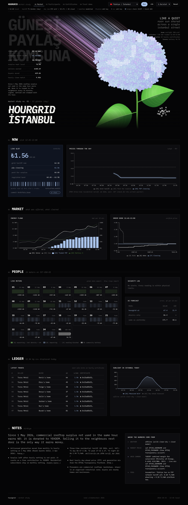

# HourGrid

**Peer-to-peer rooftop-solar trading with hourly clean-energy certificates, run by AI agents and settled on-chain every 15 minutes.**

IEEE ClimateChain Hackathon 2026 · Track: *Renewable Energy & Energy Trading*

**Three markets, one platform.** Switch between 🇹🇷 Türkiye (İstanbul, Konya), 🇮🇳 India (Amaravati, Delhi) and 🇩🇪 Germany (Freiburg, Berlin) from the top bar. Each brings its own currency, time-of-day tariff, surplus compensation, network charges, grid emission factor, regulation and real data feeds.

| | 🇹🇷 Türkiye (default) | 🇮🇳 India | 🇩🇪 Germany |
|---|---|---|---|
| Why P2P now | Since **1 May 2026**, commercial rooftop surplus not used in the same hour earns **₺0** (donated to YEKDEM). Neighbours are the only buyer that pays | P2P pilots live in Delhi & UP, but trade volumes are tiny | Energy sharing (§42c EnWG) legal since **1 June 2026** |
| Tariff | EPDK three-time T1/T2/T3 (Q2 2026) | ToD: solar hours −20%, peak +10% | 37 ct/kWh, or dynamic = day-ahead + 28 ct |
| Surplus paid | ₺0 after hourly netting | ₹2.50 feed-in (placeholder) | 7.70 ct EEG |
| Real data | Weather · **EPİAŞ day-ahead PTF** · **live CO₂ from EPİAŞ generation mix** | Weather (no open market API) | Weather · **Energy-Charts day-ahead** · **live grid CO₂** |
| Participants | Workshops in an industrial zone (OSB) sell to homes | Homes | Homes |

The UI shows a status light for every data source: **real data**, **add key** (EPİAŞ needs a free account) or **modelled** (fallback, so the demo never breaks).

India's real P2P solar pilots (Delhi, Uttar Pradesh) proved the ledger works, but hardly anyone keeps trading by hand: one pilot logged only 514 trades. And today's clean-energy certificates are 1 MWh and annual, so a household can't prove its evening EV charge was solar-backed. HourGrid fixes both:

- **AI agents trade for you.** Each home's agent forecasts its own solar and consumption and places orders automatically, within limits the owner sets in plain language.
- **A 15-minute double auction** clears at one uniform price inside the regulated band (feed-in rate ↔ Time-of-Day tariff), with the network charges approved for India's pilots.
- **Every traded kWh becomes an hour-stamped certificate** (ERC-1155, 1 unit = 1 Wh) that can be retired exactly once.
- **Fraud-resistant by design.** Meters sign readings (EIP-712), a physics oracle rejects physically impossible exports using independent irradiance data, and the contracts re-check everything on-chain.
- **Microgrid coordination.** A community battery soaks up the midday surplus and sells it into the evening peak.

## Website Link: http://hourgrid.aalingbabu.workers.dev

## What's in the box

```
contracts/   Solidity (Foundry): MeterRegistry, HourGridMarket, GranularCertificate,
             GreenHourPoints (soulbound), SettlementToken (tTRY/tINR/tEUR) · 16 tests incl. fuzzing
backend/     Python (FastAPI): live weather, neighbourhood simulator, AI forecasting,
             physics oracle, trading agents, double auction, Merkle settlement, HF assistant
frontend/    Next.js dashboard: market, participants & agents, certificate verifier, trust demo
```

**Design:** a "botanical study" on black. The hero is a live, procedurally drawn powder-blue hydrangea: a beam of pink and lavender light is the sun (brightness and length follow measured irradiance), florets open with the sun and close at night, white cross-stitch patches spread across the head with the energy traded each slot, a stitch cluster by the stem counts the hourly certificates minted, and the leaves deepen in colour with battery charge. Large background words are in the local language (Turkish "GÜNEŞİ PAYLAŞ KOMŞUNA", "share the sun with your neighbour"). One type family throughout, IBM Plex Mono (light/regular/medium/bold, real italics), self-hosted so it works offline; powder blue is the single accent for P2P prices.

| Layer | What it does |
|---|---|
| **Weather** | Live from Open-Meteo (no key) → NASA POWER → offline pvlib model fallback |
| **Market data** | Türkiye: EPİAŞ Transparency Platform (PTF + real-time generation by fuel → carbon intensity). Germany: Fraunhofer Energy-Charts (day-ahead + CO₂). India: tariff-based |
| **Simulator** | 24 participants (40% with rooftop solar; homes or, in Türkiye, workshops with business-hours load) + community battery, 15-min resolution |
| **AI forecasting** | Hybrid pvlib physics + gradient boosting for solar; gradient boosting with lags for load. Scored on a held-out window against two baselines |
| **Physics oracle** | Rejects export > panel kWp × measured irradiance × 15 min × 115%; IsolationForest flags unusual readings |
| **Agents** | Transparent ToD-aware bidding with a plain-language reason for every order; community battery agent |
| **Auction** | Uniform-price k-double auction (k = 0.5), clamped to [feed-in + fee share, grid tariff − fee share] |
| **Settlement** | One `commitInterval` per slot (order-book hash, clearing price, Merkle root), then `settleBatch` verifies each fill's Merkle proof and the meter's signed reading, moves rupees, pays fees, mints certificates |
| **Certificates** | ERC-1155 id = keccak(meterId, local hour). Gasless retirement via EIP-712 signature (households never need crypto) |
| **HF assistant** | "Never sell below ₹4.50" → agent settings; "why did you sell at noon?" → answer from the agent's own log. Falls back to rules without a token |

### Tested

- `forge test`: 16 contract tests incl. 512-run fuzz (needs Foundry; see Prerequisites) (rupees conserved, no certificate over-minting)
- `pytest backend/tests`: auction, Merkle proofs, NL parser, API smoke test
- `python backend/tests/e2e_chain.py`: full day on a real chain; checks every on-chain balance and certificate equals the backend ledger, a forged reading is blocked, and a double retirement reverts. **13/13 checks pass.**



Sample results from one simulated day in İstanbul: ~180 kWh traded, ~66% of rooftop surplus used locally (surplus that would otherwise earn ₺0), AI solar forecast error roughly 40% lower than "same as yesterday".

---

## Run it

### Prerequisites
- Python 3.11+, Node 20+
- Optional for on-chain mode: [Foundry](https://book.getfoundry.sh/getting-started/installation): you need **`anvil`** (the local chain). `forge` is only needed to recompile or run the Solidity tests: prebuilt contracts ship in `contracts/artifacts/`.
  - macOS / Linux: `curl -L https://foundry.paradigm.xyz | bash && foundryup`
  - **Windows (PowerShell)**: `foundryup` does not run in PowerShell; install the Windows binaries instead:
    ```powershell
    $bin = "$env:USERPROFILE\.foundry\bin"; New-Item -ItemType Directory -Force $bin | Out-Null
    Invoke-WebRequest https://github.com/foundry-rs/foundry/releases/download/stable/foundry_stable_win32_amd64.zip -OutFile "$env:TEMP\foundry.zip"
    Expand-Archive "$env:TEMP\foundry.zip" -DestinationPath $bin -Force
    [Environment]::SetEnvironmentVariable("Path", [Environment]::GetEnvironmentVariable("Path","User") + ";$bin", "User")
    $env:Path += ";$bin"
    forge --version
    ```

### 1 · Off-chain mode (fastest, no blockchain needed)

```bash
# backend
cd backend
python -m venv .venv && source .venv/bin/activate      # Windows: .venv\Scripts\activate
pip install -r requirements.txt
cp .env.example .env                                     # CHAIN_ENABLED=0 by default
uvicorn hourgrid.api:app --port 8000

# frontend (new terminal)
cd frontend
npm install
cp .env.example .env.local
npm run dev                                              # http://localhost:3000
```

### 2 · Local blockchain (recommended for the demo)

```bash
anvil                       # leave running (terminal 1)
```

In `backend/.env` set `CHAIN_ENABLED=1` (the RPC URL and anvil key are already filled in). Start the backend: it **deploys the contracts automatically** (from `contracts/artifacts/`, no compile step), registers all 25 meters and funds the wallets, then starts trading. Or do all of it in one go from the repo root: `./run_local.sh` (macOS/Linux) or `powershell -ExecutionPolicy Bypass -File .\run_local.ps1` (Windows; installs anvil for you if it's missing).

To recompile or run the 16 Solidity tests (optional):
```bash
cd contracts
npm install                 # OpenZeppelin
forge build && forge test
```

End-to-end check: `python backend/tests/e2e_chain.py` (with anvil running and the backend stopped).

### 3 · Public testnet (Polygon Amoy or Base Sepolia)

1. Create a fresh wallet, get test POL from the [Polygon faucet](https://faucet.polygon.technology/) (or Base Sepolia ETH).
2. In `backend/.env`:
   ```
   CHAIN_ENABLED=1
   RPC_URL=https://rpc-amoy.polygon.technology
   OPERATOR_KEY=0x<your test key>
   EXPLORER_URL=https://amoy.polygonscan.com
   SECONDS_PER_INTERVAL=8
   ```
3. `cd contracts && forge build`, then start the backend. It deploys and onboards (~60 transactions, a few minutes), and every transaction hash in the UI links to the explorer.
4. Optional: `forge verify-contract` each address from `contracts/deployments/80002.json` so judges can read the source on Polygonscan.

Never commit a key that holds real funds.

### Real Turkish market data (EPİAŞ)
Register a free account on the [EPİAŞ Transparency Platform](https://kayit.epias.com.tr/epias-transparency-platform-registration-form), then set `EPIAS_USERNAME` and `EPIAS_PASSWORD` in `backend/.env`. The price chart gains a **[04] Wholesale (real)** line with the hourly PTF, and the CO₂ figures use the live Turkish generation mix. Germany's Energy-Charts data needs no key.

### Hugging Face assistant
Put your token in `backend/.env` as `HF_TOKEN=hf_...`. Default model `Qwen/Qwen2.5-7B-Instruct` via the HF Inference Providers router; change `HF_MODEL` to any chat model your credits cover (e.g. `meta-llama/Llama-3.1-8B-Instruct`). Open any home → *Talk to the agent*.

### Useful settings (`backend/.env`)
| Variable | Default | |
|---|---|---|
| `COUNTRY` / `SITE` | `TR` / `istanbul` | also switchable in the UI (top right) |
| `CLOCK_MODE` | `demo` | `demo` = accelerated day from 06:00 today; `live` = real 15-minute slots |
| `SECONDS_PER_INTERVAL` | `4` | demo speed (also adjustable in the UI) |
| `WEATHER_PROVIDER` | `auto` | `openmeteo`, `nasa`, `offline` |
| `TARIFF_*` | per country | optional overrides; defaults and their sources are in `backend/hourgrid/countries.py` |

---

## Demo script (≈4 min)

1. **Problem (0:00–0:30).** Türkiye switched rooftop netting to hourly on 1 May 2026: a workshop's unused midday solar now earns ₺0. India's P2P pilots trade almost nothing because people don't trade by hand. And today's certificates can't prove clean energy by the hour.
2. **Morning (0:30–1:15).** Market page: the dot-matrix sun rises with live irradiance. Open a prosumer: AI forecast vs actual, and the plain-language reason behind each order.
3. **Clearing (1:15–2:15).** Order book chart, uniform price inside the regulated band, the barcode generated from the slot's Merkle root, commit/settle transactions on the explorer.
4. **Trust (2:15–2:50).** Trust demo: inject a fake 3 kWh reading → blocked by the physics oracle. Try double claim → first retirement accepted on-chain, second reverted by the contract.
5. **Proof (2:50–3:30).** Retire a certificate for "EV charge", open the verifier: meter → signed reading → trade → settlement → retirement.
6. **Impact & adoption (3:30–4:00).** KPIs: local use of surplus, seller earnings vs grid buy-back, buyer savings vs ToD tariff, hourly clean-energy match. Switch the country live (Türkiye → India → Germany) to show the same platform adapts to three regulatory regimes; runs as a distribution-company-operated layer (OSB / DISCOM / DSO).

## How it maps to the judging criteria

| Criterion | Evidence |
|---|---|
| Climate impact | More rooftop solar used locally and shifted into the evening peak; hourly clean-energy match; CO₂ displaced |
| Innovation | Retail P2P + hourly granular certificates + AI liquidity agents + physics oracle in one flow |
| Technical execution | Signed meters, Merkle-batched settlement, retire-once ERC-1155, fuzz tests, real weather data, measured forecast skill, on-chain ↔ ledger reconciliation test |
| Practical usefulness | Mirrors live DERC/UPERC pilot rules (DISCOM onboarding, fees, price band, billing-style escrow); gasless for households |
| Presentation | One street, one day, one attack, one verifiable certificate |

## Design notes & limits (say these in the pitch)

- **Regulation:** India allows P2P inside regulator-approved pilots; Germany allows energy sharing since June 2026; Türkiye has no retail P2P regime yet (the network fee in the TR profile is an assumption), but hourly netting makes the economic case. HourGrid is designed as grid-operator infrastructure: only the operator onboards meters, escrow mirrors bill settlement, fees are configurable per regime.
- **Data trust:** a signed meter proves *which* device reported, not that it's true. The physics oracle bounds fraud; production would use DISCOM AMI data.
- **Double counting:** one certificate id per meter-hour, minted only against signed export, burned on retirement. A national-registry bridge (REC/I-REC cancellation) would be needed in production.
- **Scale & gas:** one commit per slot regardless of homes; per-trade settlement is permissionless and can be batched or claimed lazily. Physical dispatch never goes on-chain.
- **Battery energy** is settled but doesn't mint new certificates (stored-energy certificate rules are an open EnergyTag topic; a stretch goal).
- Simulated households and meters. India's tariff values are placeholders; Türkiye's are the Q2 2026 EPDK three-time tariff excl. VAT; check each for the current quarter.
